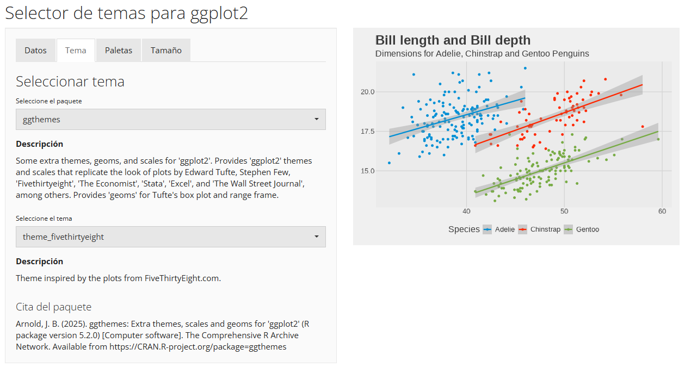

# Selector de temas para ggplot2

Aplicación Shiny que permite cargar un objeto `ggplot` y aplicarle de forma dinámica distintos temas, para comparar rápidamente estilos y elegir el más adecuado. Reúne más de 200 temas de 60 paquetes de R disponibles en CRAN y GitHub.

Presentada como charla relámpago en [LatinR 2023](https://2023.latinr.org/).

Disponible en: https://sgs2000.shinyapps.io/themeselector/



## Uso

Guarde su gráfico con `save()`:

```r
library(ggplot2)

mi_grafico <- ggplot(mtcars, aes(wt, mpg)) + geom_point()
save(mi_grafico, file = "mi_grafico.Rdata")
```

Luego abra la aplicación. La barra lateral tiene cuatro paneles:

- **Datos**: carga del archivo `.Rdata`, o selección de un gráfico de muestra (creados con `palmerpenguins`) si solo se quieren ver los temas.
- **Tema**: selección de un paquete y de un tema dentro de él. Se muestran la descripción de la función y del paquete, y la cita del paquete en formato APA.
- **Paletas**: selección de una paleta de colores para los atributos `fill` o `color` del gráfico.
- **Tamaño**: alto y ancho opcionales del gráfico, útiles cuando los valores por defecto no se ven bien en el monitor.

## Desarrollo

Construida con `shiny`, `shinyWidgets` y `shinyjs`. Las fuentes de texto se manejan con `showtext`, las descripciones de las funciones se extraen con `sofun` y las citas APA se generan con `tfse`.
